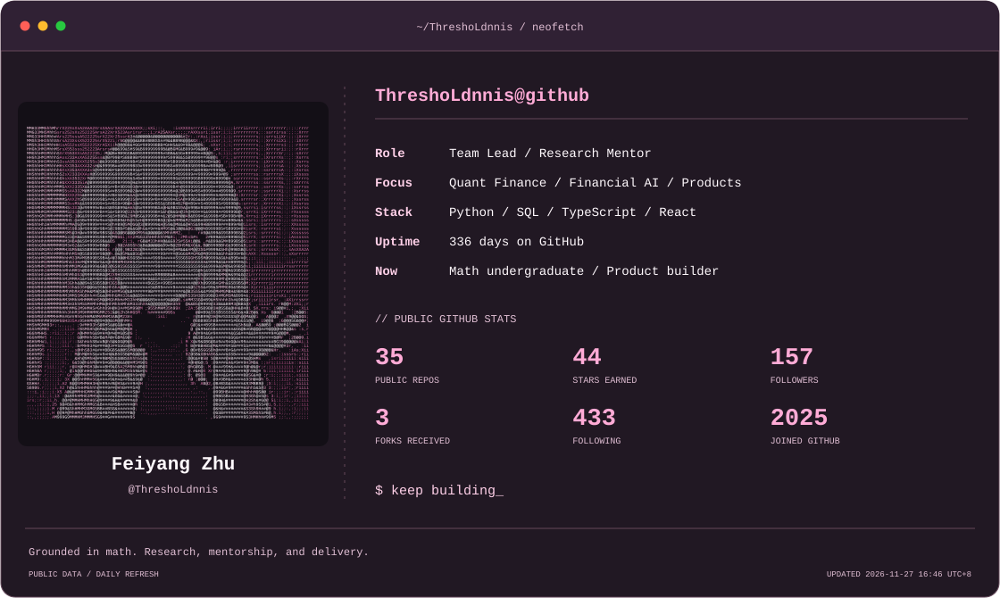

<!-- Generated by scripts/generate_profile.py. Edit profile.json to customize. -->
<picture>
  <source media="(max-width: 640px) and (prefers-color-scheme: dark)" srcset="https://raw.githubusercontent.com/ThreshoLdnnis/ThreshoLdnnis/main/assets/profile-mobile-dark.svg?v=6ac5114ce1ef">
  <source media="(max-width: 640px)" srcset="https://raw.githubusercontent.com/ThreshoLdnnis/ThreshoLdnnis/main/assets/profile-mobile-light.svg?v=f2829b7feca7">
  <source media="(prefers-color-scheme: dark)" srcset="https://raw.githubusercontent.com/ThreshoLdnnis/ThreshoLdnnis/main/assets/profile-dark.svg?v=e9bb6692b215">
  
</picture>

### Hi, I’m Feiyang Zhu (Mofarigano)

I'm a Mathematics and Applied Mathematics undergraduate working across quantitative finance, financial AI, product design, and software engineering. I lead research teams, mentor contributors, and help interdisciplinary projects move from a question to a reproducible result or a working product.

I assist an economics and management faculty team at Tsinghua University's Shenzhen International Graduate School, focusing on computing-related product research. I'm also a Tsinghua x-lab member and president of my university's Mathematical Modeling Association.

Previously: Quantitative Research Intern at Two Sigma (Hong Kong, 2025–2026); HR Intern at Alibaba International (Shenzhen, 2024).

### Connections & Collaborations

I’ve built lasting connections with the companies, universities, and organizations below through collaborative projects, working relationships, and participation in their official programs, events, and competitions with formal review or selection processes.

  
  
  
  
  
  
  
  
  
  

### Research I Lead & Mentor

**Team Lead & Research Mentor across all five projects.** I shape research questions, design methods, plan tasks, guide contributors, review experiments and implementations, and integrate the team's results.

| Research project | Focus |
| :--- | :--- |
| Credit Risk & Explainable ML | WOE/IV scorecards, LightGBM, SHAP, and reproducible model comparison. |
| A-share Multi-factor Research | Point-in-time alignment, factor construction, neutralization, IC analysis, and backtesting. |
| Financial Research Assistant | Financial-document RAG, hybrid retrieval, cited answers, extraction, and quality/latency/cost evaluation. |
| Regime-aware Factor Allocation | Market-state indicators, dynamic weighting, rolling out-of-sample tests, and robustness checks. |
| ML Stock Selection & Explainable Alpha | Ridge and LightGBM, stock ranking, cost-aware backtesting, SHAP, and feature ablation. |

I care about point-in-time data, preventing leakage, out-of-sample evaluation, interpretability, and reproducibility—and helping teammates understand the methods behind their work.

### Products & Engineering

- **[Lingyu](https://github.com/ThreshoLdnnis/Qsinghua-TencentSmaker) — Independent product designer & developer.** Designed and launched a student growth platform with bilingual interfaces, permissions, content management, and responsive design.
- **TAP — Independent product designer & developer.** Designed and launched a digital business card workshop website with bilingual content and interactive card demonstrations.
- **PACT — Product architecture & team integration.** Contributed to a banking-agent sandbox: task workflows, context clarification, replanning, execution states, and integration.
- **[CookIdea](https://github.com/ThreshoLdnnis/Cook-Idea) — Product initiator & prototype builder.** Created a cooking-inspired creativity workspace and interactive frontend prototype, currently powered by local rules and templates.

Other team roles: Project Manager for 3D ReFab (six-person team), team captain for MetaCruise, and co-initiator/core contributor to Fastyle NailBot.

### Tools & Practice

**Research:** Python, SQL, pandas, DuckDB, scikit-learn, LightGBM, SHAP  
**Applications:** TypeScript, React, Next.js, Tailwind CSS, Three.js, FastAPI, PostgreSQL  
**Team delivery:** Issue planning, PR reviews, testing, deployment, reproducible workflows, and technical documentation  

Learning in public: [Quant-for-babies](https://github.com/ThreshoLdnnis/Quant-for-babies).

Away from the keyboard: Tennis, badminton, hiking, photography, travel, and FPS games.

Stats cover owned public repositories. Uptime = GitHub account age. Refreshed daily with GitHub Actions.
